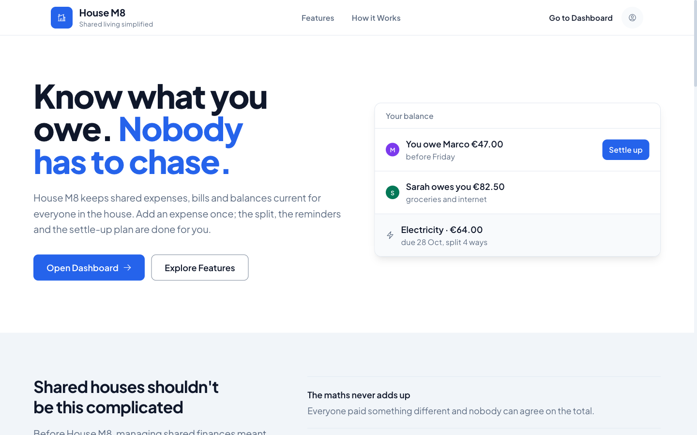
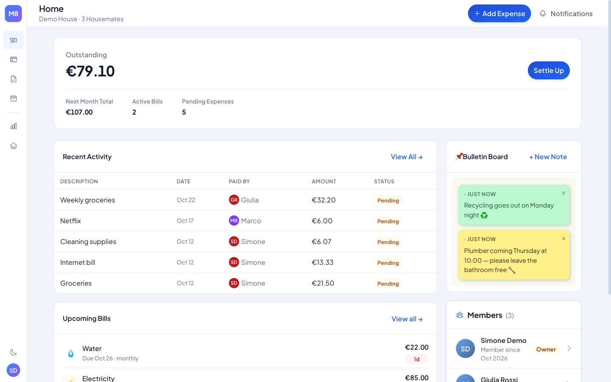
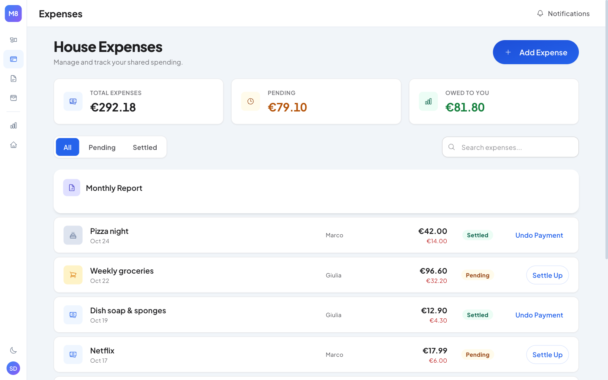
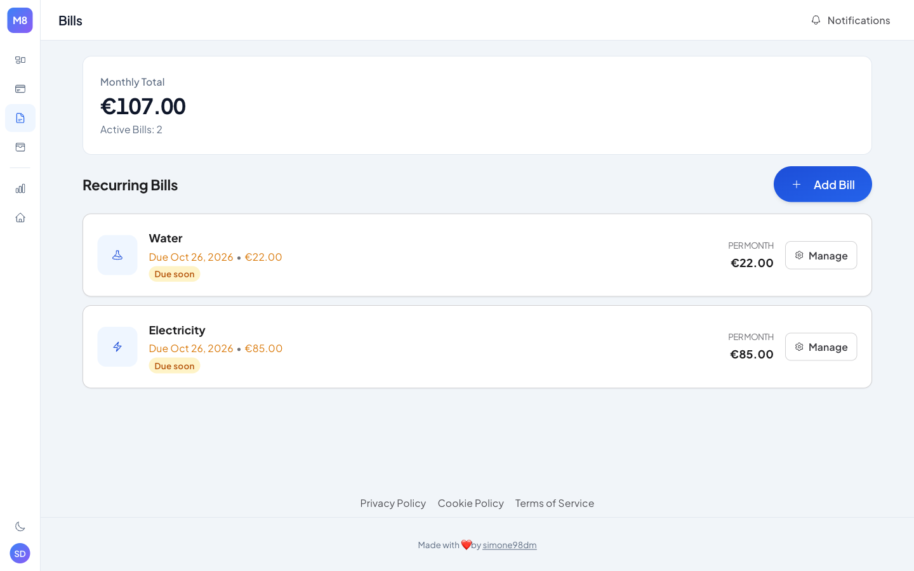
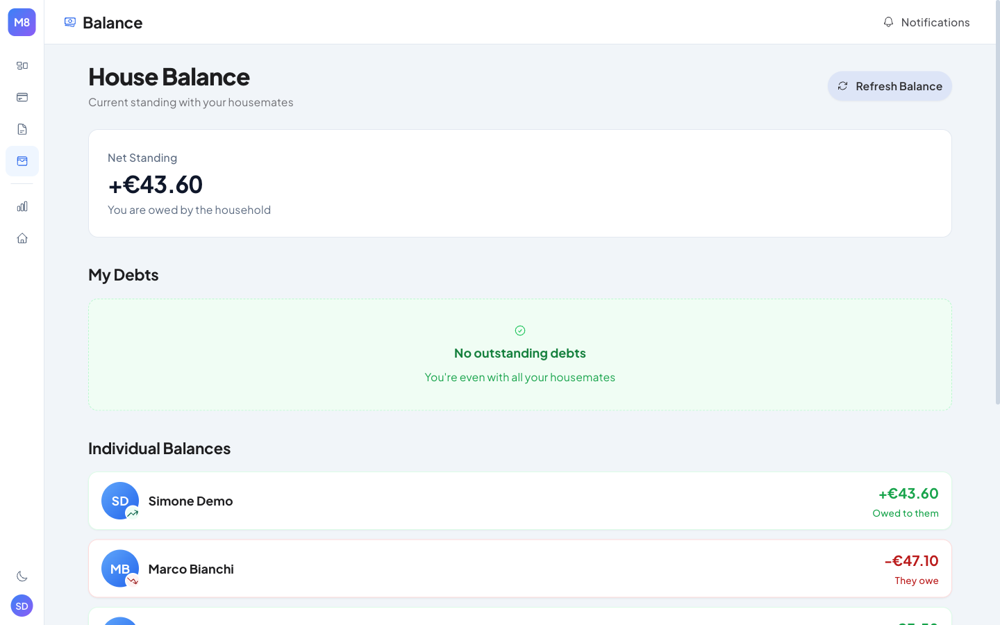
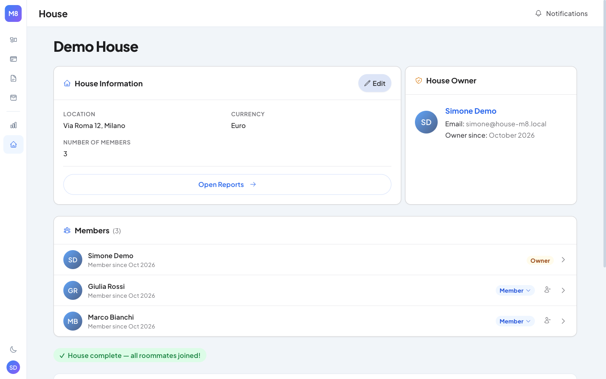
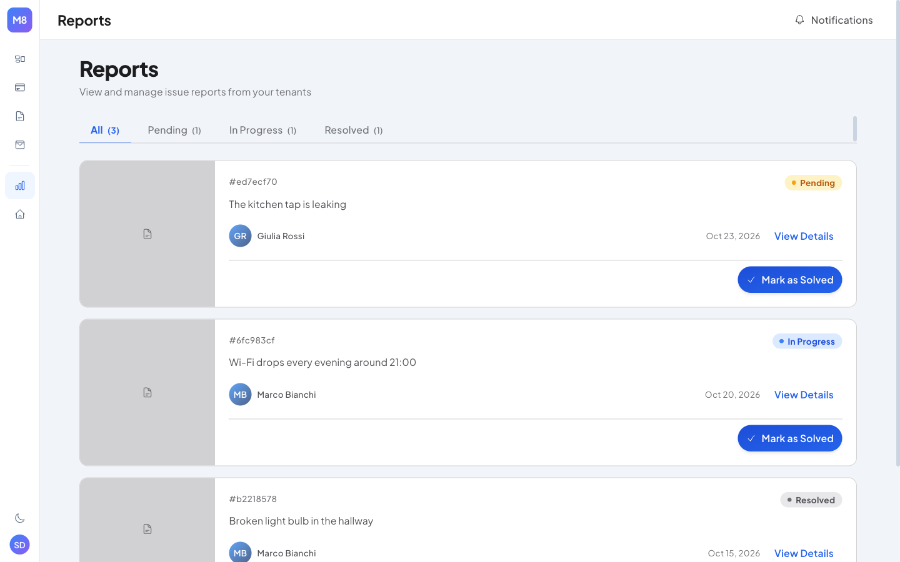
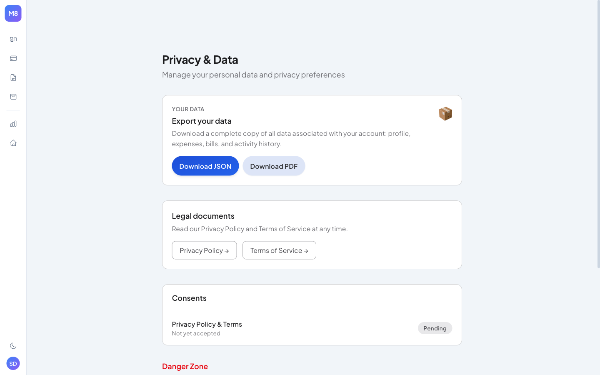
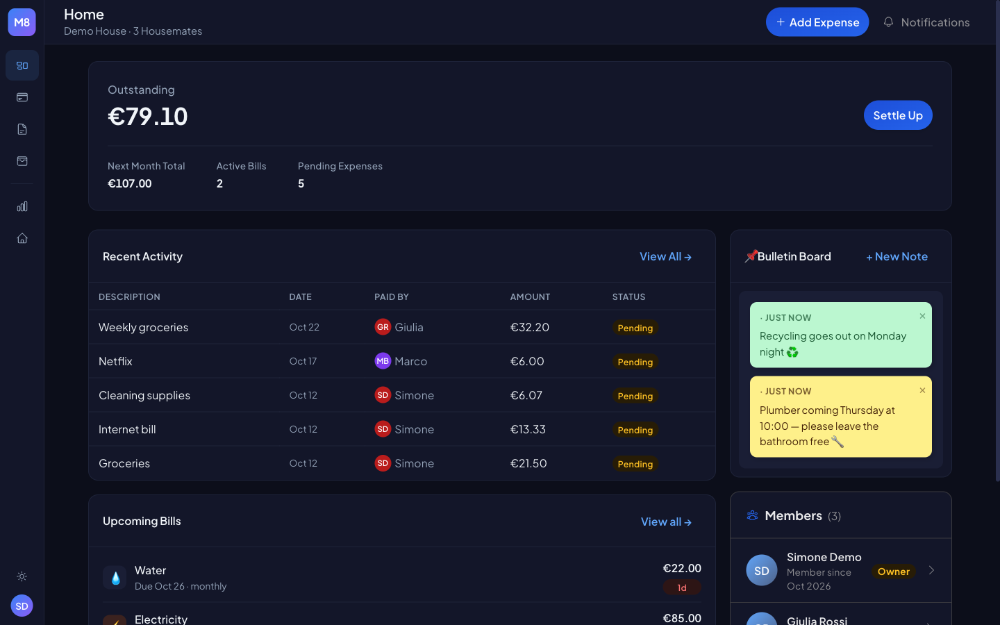

# 🏠 House M8

> **Stop fighting over who owes what.** House M8 is a shared-living finance app for roommates — split expenses, track recurring bills, check the house balance, and keep everyone in the loop, all in one place.

[](https://opensource.org/licenses/MIT)
[](https://nuxt.com)
[](https://vuejs.org)
[](https://www.typescriptlang.org)

---

## ✨ Features

### 💸 Expenses
- Log any shared expense and split it equally across selected housemates
- Track who has paid their share and who still owes
- Recurring expenses with weekly / monthly / yearly periods
- Filter by status (all / pending / settled) and search by description
- Download a monthly **PDF** report of the house expenses

### 🏷️ Categories & Add flow
- One Add modal: "Does it repeat?" off creates an expense, on creates a bill
- Flow: description, amount, guessed category (change it if wrong), then submit; "Paid by you · split with everyone" with an Edit disclosure; one-off expenses have no due date
- Split defaults to everyone; choose who paid
- Eight spending categories (groceries, home, energy, water, internet, subscriptions, eating out, other) with a bilingual (EN/IT) auto-guess from the description

### 📋 Bills
- Manage recurring fixed costs (rent, internet, utilities)
- Configurable payment periods (every 1, 2, 6 or 12 months)
- Due-date tracking and reminders via cron job

### ⚖️ Balance
- Real-time net balance per user — who owes whom and how much
- Minimal settlement plan: the least number of transfers to clear all debts
- One-click settlement between two users, with a 10-second undo (no confirm modal); creditors can also mark a payment as received
- Per-expense "Pay back" is immediate too, with the same 10-second undo; undone payments are hidden on Home and collapsed on Balance
- Bill and expense rows show your share, with the total as "of €X"

### 🏘️ Houses
- Create and switch between multiple houses
- Role-based access: **owner**, co-admin and member; the owner is listed with the members (Owner badge) and each member has one overflow menu to change role or remove
- One-sentence house summary on the House page
- Invite someone by email or 6-digit code from a single modal
- Configurable member capacity

### 📌 Bulletin Board
- Post sticky notes visible to all housemates
- Optional expiry date per note

### 📄 Reports
- Members can submit issue reports to the house owner
- Owners see a status line (overdue, due within 7 days, open reports, unsettled amount)
- Attach images, track status (pending → in progress → resolved)

### 👤 Profile & Settings
- Profile: name, avatar and optional bio, occupation, languages, social links (visible to housemates only with your consent)
- GDPR controls: data export (JSON download), profile-sharing consent, account deletion with a 30-day grace period
- Per-user currency preference (EUR, USD)

### 🔐 Auth
- Email + password registration with email verification
- Google OAuth one-click sign-in
- JWT access + refresh token pair (HTTP-only cookies)

### 🌍 Platform
- 🌙 Full dark mode via `@nuxtjs/color-mode`
- 🌐 English and Italian (`@nuxtjs/i18n`)
- 💳 Stripe-powered subscription plans
- 🚩 Feature flags (env-based or Vercel Edge Config)

---

## 📸 Screenshots

### Landing page


### Dashboard


| Expenses | Bills |
|----------|-------|
|  |  |

| Balance | House |
|---------|-------|
|  |  |

| Reports | Privacy & Data |
|---------|----------------|
|  |  |

### Dark mode


---

## 🚀 Quick Start

```bash
# 1. Clone
git clone https://github.com/simone98dm/house-m8-fe.git
cd house-m8-fe

# 2. Install
# @simone98dm/layer is published on GitHub Packages. .npmrc reads the token
# from GITHUB_TOKEN (read:packages scope) and yarn refuses to run without it.
export GITHUB_TOKEN=$(gh auth token)
yarn

# 3. Start the database
docker compose up -d

# 4. Configure environment
cp .env.example .env.development   # `yarn dev` loads .env.development
# edit it — at minimum set the POSTGRES_* variables and JWT_SECRET

# 5. (Optional) Seed demo data
yarn db:seed
# → login: simone@house-m8.local / MockDemo1!

# 6. Run
yarn dev
# → http://localhost:3000
```

For full environment setup, migrations, and optional services (Google OAuth, Stripe, email) see **[docs/setup.md](docs/setup.md)**.

---

## 🛠️ Tech Stack

| Layer | Technology |
|-------|------------|
| Framework | Nuxt 4 (Vue 3.5 + Nitro) |
| Language | TypeScript 6 |
| State | Pinia 4.x |
| Database | PostgreSQL 16 (`pg`, no ORM) |
| Styling | Tailwind CSS 4 (`@tailwindcss/vite`) |
| Auth | JWT (`jose`) + bcrypt + Google OAuth |
| Email | Resend |
| Payments | Stripe |
| PDF | pdf-lib |
| Testing | Vitest + Vue Test Utils + Cypress |
| Deployment | Vercel |

---

## 📚 Documentation

| Document | Description |
|----------|-------------|
| [Architecture](docs/architecture.md) | 4-layer pattern, repository design, request lifecycle |
| [API Reference](docs/api.md) | All endpoints, request/response shapes, auth guards |
| [Database](docs/database.md) | Schema, migrations, balance calculation, portability |
| [Frontend](docs/frontend.md) | Component model, stores, API client, i18n, dark mode |
| [Setup Guide](docs/setup.md) | Prerequisites, env vars, migrations, scripts, deployment |
| [Auth Flows](docs/auth-flows.md) | Registration, login, email confirmation, onboarding, invitations |
| [Design System](DESIGN.md) | Kinetic Gallery — colors, typography, elevation, motion |
| [Contributing](CONTRIBUTING.md) | Branch conventions, commit format, PR process |
| [Changelog](CHANGELOG.md) | Release history |
| [OpenAPI spec](openapi.yaml) | Machine-readable API spec |
| [Postman collection](postman-collection.json) | API request collection |

---

## 🤝 Contributing

1. Fork the repo
2. Create a branch: `git checkout -b feature/amazing-feature`
3. Commit using [conventional commits](https://www.conventionalcommits.org/): `feat:`, `fix:`, `chore:`, `docs:`
4. Open a pull request

Husky + commitlint enforce the commit format automatically.

See [CONTRIBUTING.md](CONTRIBUTING.md) for the full guide.

---

## 📄 License

MIT — see [LICENSE](LICENSE).

---

## 🙋 Contact

**GitHub**: [@simone98dm](https://github.com/simone98dm) · **Project**: [github.com/simone98dm/house-m8-fe](https://github.com/simone98dm/house-m8-fe)
