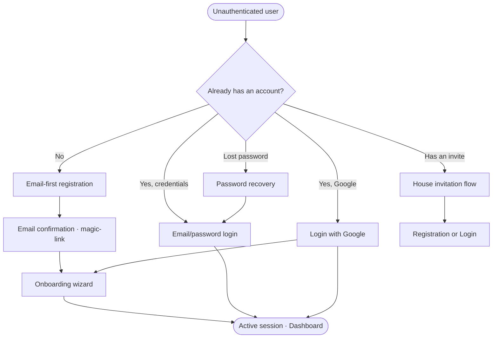
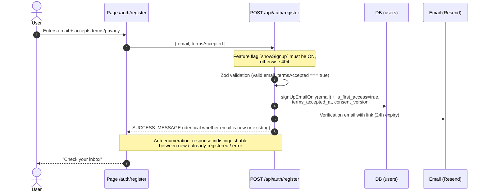
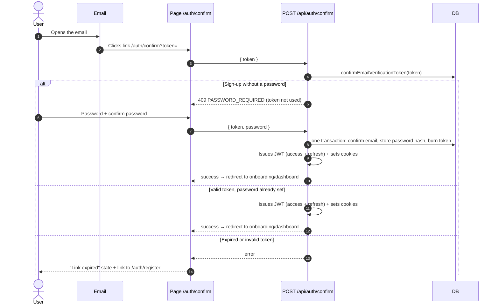
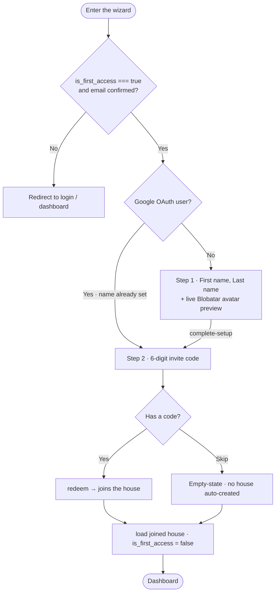
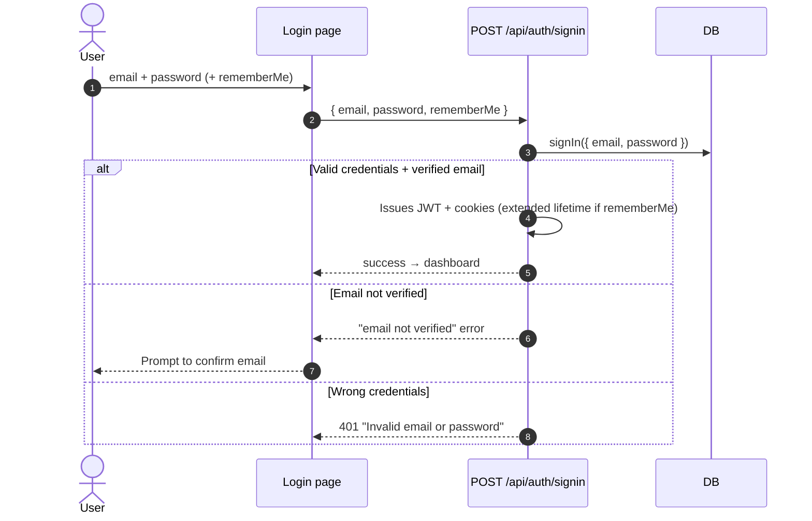
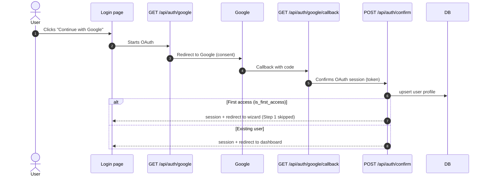
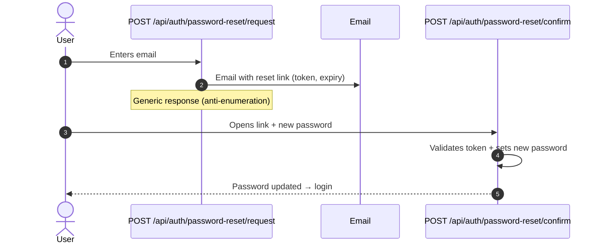
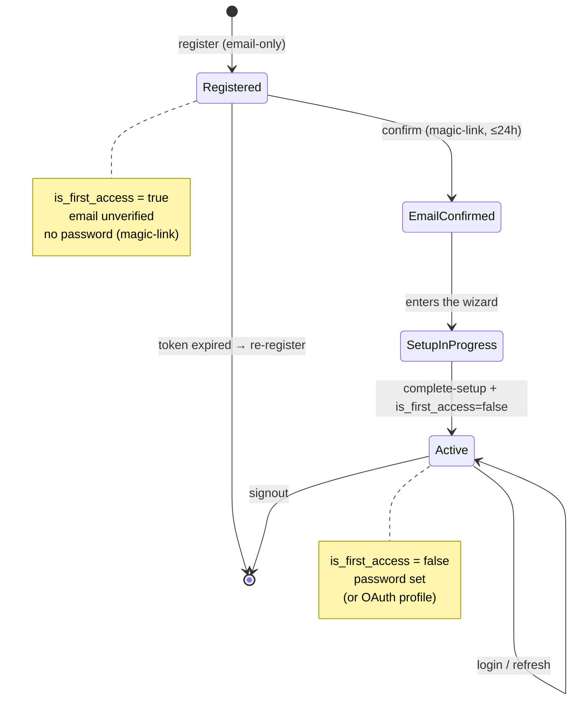

# Authentication & Onboarding — High-Level Documentation

Overview of the **registration**, **login**, **email confirmation**, **onboarding**, and **invitation** flows in House-m8.
Architectural reference document: it describes the user journeys, conditions, and requirements — not the line-by-line implementation.

> Reference architecture: `Component → Page → Store → Composable → Server API → Repository`.
> All data is scoped to `project_id`. Zod validation on every server input.

---

## 1. Entry-point map

**Endpoints involved**

| Area                       | Endpoint                                                                                                    |
| -------------------------- | ----------------------------------------------------------------------------------------------------------- |
| Registration               | `POST /api/auth/register`                                                                                   |
| Email confirmation         | `GET /api/auth/verify-email`, `POST /api/auth/confirm`                                                      |
| Login                      | `POST /api/auth/signin`, `POST /api/auth/signout`, `POST /api/auth/refresh`                                 |
| Google OAuth               | `GET /api/auth/google`, `GET /api/auth/google/callback`                                                     |
| Password recovery          | `POST /api/auth/password-reset/request`, `POST /api/auth/password-reset/confirm`                            |
| Setup wizard               | `POST /api/user/complete-setup`                                                                             |
| Invitations (token link)   | `GET /api/invitation/[token]`, `GET /api/invitation/[token]/preview`, `POST /api/invitation/[token]/accept` |
| Invitations (6-digit code) | `POST /api/invitation/redeem`                                                                               |

---

## 2. Registration (email-first)

The user provides **only their email** plus consent. The password is chosen on the confirmation link (§3); the name is collected in the wizard (§4).

**Requirements & conditions**

- Feature flag **`showSignup`** enabled — otherwise the endpoint returns `404`.
- Consent is mandatory: `termsAccepted === true` (recorded as `terms_accepted_at` + `consent_version`).
- **Anti-enumeration**: new email, already-registered email, and internal failure all return the **same** success response. No verification email is re-sent for an already-existing email.
- User is created with `is_first_access = true` (wizard trigger).
- The verification email is best-effort (non-blocking send).

---

## 3. Email confirmation — magic-link

The link confirms the email. A new sign-up has no password yet, so the page asks for one first; confirming the email, storing the password and signing in then happen together.

**Requirements & conditions**

- Token valid for **≤ 24h** and **single-use**.
- On expired/invalid token: dedicated screen offering a restart from registration.
- A sign-up with no password answers `409 PASSWORD_REQUIRED` without using the token; the password (8–72 chars) is sent with the token and stored in the same transaction, logged as `password_set`.
- A confirmation link never replaces an existing password, and email-change links never ask for one or sign in.
- On confirmation, the JWT session (cookies) is issued — this is what unlocks access to the wizard.
- The same `confirm` endpoint also handles **OAuth** (Google) session confirmation.

---

## 4. Onboarding wizard

Active when `is_first_access === true`. The layout redirects here until setup is complete.

**Requirements & conditions**

- **Guard**: accessible only with `is_first_access === true` + confirmed email (deep-link protection).
- **Step 1** — Name:
  - First and last name; the avatar (Blobatar) is drawn from the name as it is typed.
  - Saved via `POST /api/user/complete-setup`, which sets the name only (never a password) and **rejects with 409** if setup is already complete.
  - **Google users skip Step 1** (name already set by the provider).
- **Step 2** — 6-digit invite code:
  - **Optional** — "Skip" button.
  - Skip → **existing empty-state**, no house auto-created. The user creates or joins a house later via the normal UI.
  - `OtpCodeInput` component: 6 single inputs, continuous typing, backspace navigates back, distributed 6-digit paste, `inputmode="numeric"`, `autocomplete="one-time-code"`, fully accessible.
- Uploaded profile pictures are paused, so there is no picture step.
- On finish: a redeemed code's house is loaded into the store, then `is_first_access = false` → the wizard is no longer shown.

---

## 5. Login (email / password)

**Requirements & conditions**

- Email must be verified: login with an unconfirmed email is handled with a dedicated error.
- Wrong-credentials message is **generic** ("Invalid email or password") — it does not distinguish a non-existent email from a wrong password.
- `rememberMe` extends the session lifetime.
- Session renewal via `POST /api/auth/refresh`; logout via `POST /api/auth/signout`.

---

## 6. Google OAuth

**Requirements & conditions**

- On first access the OAuth user enters the wizard but **skips Step 1** (name/password already provided by the provider).
- The profile is created/updated (`upsert`) on callback.
- Shares `POST /api/auth/confirm` with the magic-link flow for session issuance.

---

## 7. Password recovery

**Requirements & conditions**

- Reset request → generic response regardless of whether the email exists (anti-enumeration).
- Reset token has an expiry and is single-use.
- New password subject to the same strength constraints (≥ 8 characters).

---

## 8. House invitations

Two **coexisting mechanisms**, generated together for the same invitation. Both land in the **same email** to the new member.

```mermaid
flowchart LR
    Owner([Existing member]) --> Gen[Generates invitation]
    Gen --> Mail[Email to new member]
    Mail --> Link[Token link · URL]
    Mail --> Code[6-digit code]

    Link --> Accept[GET /api/invitation/&#91;token&#93;<br/>preview → accept]
    Code --> Redeem[Wizard Step 2<br/>POST /api/invitation/redeem]

    Accept --> House([House member])
    Redeem --> House
```

| Mechanism            | How it's used                   | Endpoint                 | Notes                                   |
| -------------------- | ------------------------------- | ------------------------ | --------------------------------------- |
| **Token link (URL)** | Click the link in the email     | `[token]` preview/accept | Legacy mechanism, unchanged             |
| **6-digit code**     | Typed into Step 2 of the wizard | `redeem`                 | New; the only entry point is the wizard |

**Requirements & conditions (6-digit code)**

- **Single-use** — invalidated after the first successful use.
- **24h expiry** (aligned with the confirmation link).
- **Rate-limit + lockout** on failed attempts (10⁶ space → brute-force protection is mandatory): `code_attempts` / `code_locked_until` counters.
- Scoped to `project_id`.
- The two mechanisms **coexist**: the token link is unchanged; the code is generated in addition and included in the same email.

---

## 9. Global conditions — summary

| Condition                       | Where it applies                 | Value                               |
| ------------------------------- | -------------------------------- | ----------------------------------- |
| Feature flag `showSignup`       | Registration                     | Must be ON, otherwise 404           |
| Terms/privacy consent           | Registration                     | Mandatory, tracked with version     |
| Email confirmation token expiry | Confirmation / magic-link        | 24h, single-use                     |
| 6-digit invite code expiry      | Invitations                      | 24h, single-use                     |
| Token invite link expiry        | Invitations                      | Unchanged (existing flow)           |
| Rate-limit + lockout            | Registration, code redeem        | Anti mailbomb / anti brute-force    |
| Anti-enumeration                | register, password-reset, signin | Generic/indistinguishable responses |
| Wizard guard                    | Onboarding                       | `is_first_access` + confirmed email |
| Skip Step 1                     | Onboarding                       | Google OAuth users only             |
| Skip Step 2                     | Onboarding                       | Always allowed → empty-state        |
| Password                        | Setup / reset                    | ≥ 8 characters                      |

---

## 10. User state model

---

_High-level document. For implementation detail see `docs/auth-onboarding-refactor-implementation.md` and the code in `server/api/auth/`, `server/api/invitation/`, `app/pages/auth/`, `app/components/user/AccountSetupWizard.vue`._
